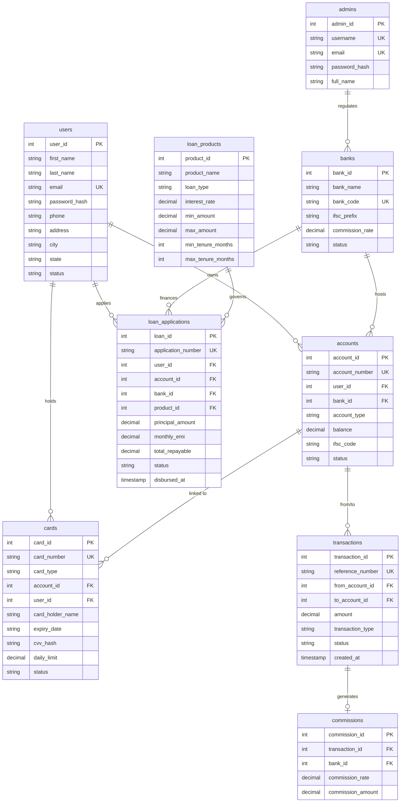

# 🏦 E-Banking Management System

> **A Pure Monolithic Jakarta EE Banking Platform with Multi-Bank Institutional Architecture**  
> Built with **Java 21**, **Jakarta EE 10 (Servlet 6.0 & JSP 3.1)**, **Raw JDBC**, and **MySQL**, deployed on **Apache Tomcat 11**.  
> *Engineered without Spring Boot, Hibernate, or external JS frameworks — pure, production-grade monolithic MVC.*

---

## 📌 Table of Contents
1. [Project Overview](#-project-overview)
2. [Architectural Highlights](#-architectural-highlights)
3. [Core Functional Modules](#-core-functional-modules)
4. [Technology Stack](#-technology-stack)
5. [Database Architecture & Entity-Relationship](#-database-architecture--entity-relationship)
6. [Project Directory Layout](#-project-directory-layout)
7. [Demo Test Credentials](#-demo-test-credentials)
8. [Step-by-Step Installation & Running Guide](#-step-by-step-installation--running-guide)
9. [Application Route Sitemap](#-application-route-sitemap)
10. [Financial Integrity & Security Safeguards](#-financial-integrity--security-safeguards)

---

## 🌟 Project Overview

The **E-Banking Management System** simulates a central platform banking authority connecting major institutional partner banks (**State Bank of India, HDFC Bank, ICICI Bank, Axis Bank, Punjab National Bank**) with retail customer accounts. 

Unlike conventional single-bank projects, this platform introduces:
- **Central Platform Governance**: Regulates partner banks, institutional commission rates, and compliance.
- **Double-Entry Financial Transactions**: Inter-bank and intra-bank fund transfers with automated platform commission cuts.
- **Virtual Cards Desk**: Issuer simulation of Debit and Credit cards with masked representations and real-time security freeze controls.
- **Loans & EMI Engine**: Dynamic compounding interest calculations, instant online applications, and administrative atomic disbursals directly into customer account balances.
- **Multi-Page Dedicated Routing**: Clean, uncluttered KPI Command Centers on the dashboards with separate dedicated pages for every banking service.

---

## 🏛️ Architectural Highlights

```
                          ┌───────────────────────────┐
                          │   Central Platform Admin  │
                          └─────────────┬─────────────┘
                                        │
                 ┌──────────────────────┼──────────────────────┐
                 ▼                      ▼                      ▼
        ┌─────────────────┐    ┌─────────────────┐    ┌─────────────────┐
        │   HDFC Bank     │    │   ICICI Bank    │    │ State Bank of   │
        │ (Commission 0.75%)│  │ (Commission 0.60%)│  │  India (0.50%)  │
        └────────┬────────┘    └────────┬────────┘    └────────┬────────┘
                 │                      │                      │
                 └──────────────────────┼──────────────────────┘
                                        │
                           ┌────────────▼───────────┐
                           │    Customer Accounts   │
                           │  (Savings & Current)   │
                           └────────────┬───────────┘
                                        │
                 ┌──────────────────────┼──────────────────────┐
                 ▼                      ▼                      ▼
        ┌─────────────────┐    ┌─────────────────┐    ┌─────────────────┐
        │ Atomic Transfers│    │  Virtual Cards  │    │   Loans & EMI   │
        │ & Ledger Passbook│   │ (Debit/Credit)  │    │  Auto-Disbursal │
        └─────────────────┘    └─────────────────┘    └─────────────────┘
```

- **Pure MVC Design**: Strict separation between Data Models (`MySQL`), Business Logic Controllers (`Jakarta Servlets`), and Presentation Views (`JSP + CSS3 + Vanilla JS`).
- **Atomic Double-Entry Transactions**: All balance updates use transaction management (`con.setAutoCommit(false)` and `con.commit()`) with automatic rollback on errors or overdrafts.
- **Automated Commission Engine**: Every fund transfer computes a proportional commission revenue cut retained by the platform from the holding partner bank.
- **High-Performance Light Footprint**: Instant startup (< 500 ms) and small memory footprint without heavyweight framework overhead.

---

## 🧩 Core Functional Modules

### 1. Authentication & Role-Based Access Control (RBAC)
- **Unified Portal**: Seamless tab-toggle interface switching between **Customer Internet Banking** and **Central Administrative Authority**.
- **Session Protection**: All servlets validate active HTTP sessions, verifying user or admin identities and role authorizations.
- **Instant Demo Autofill**: One-click demo credential fillers for swift evaluator testing.

### 2. Customer Dashboard & Self-Service Portal
- **Financial KPI Cards**: Real-time summary displaying **Total Combined Balance**, **Active Accounts**, **Virtual Cards**, and **Disbursed Loans**.
- **Service Choice Hub**: Direct action cards linking to dedicated sub-pages:
  - **My Bank Accounts**: Inspect accounts held across institutions, balance tracking, and IFSC codes.
  - **Open New Account**: Instant 12-digit account number generation with partner bank linkage.
  - **Transactions & Transfers**: Deposit cash, withdraw funds, and transfer money between accounts with live passbook records.
  - **Virtual Cards**: Manage virtual Debit and Credit cards, daily limits, and security freeze toggles.
  - **Loans & EMI**: Browse partner bank loan schemes, compute monthly EMI installments, and apply online.
  - **KYC Profile**: View registered personal records and update residential addresses.

### 3. Central Platform Administration Portal
- **Command Center**: Clean, uncluttered KPI summary showing platform-wide metrics (Customers, Accounts, Partner Banks, Total Deposits, Platform Commissions, Loan Outlays).
- **Dedicated Administrative Desks**:
  - **🏛️ Partner Banks (`/admin/banks`)**: Onboard partner institutions, adjust commission rates, and toggle active/suspended operational status.
  - **👥 Customers Desk (`/admin/customers`)**: Comprehensive customer directory with name/email search, KYC location details, and account suspension controls.
  - **🏦 Accounts Desk (`/admin/accounts`)**: System-wide ledger of all accounts with filters by partner bank and account type (`SAVINGS`/`CURRENT`).
  - **💳 Financial Ledger (`/admin/transactions`)**: Full double-entry platform ledger with transaction type filters and commission breakdown.
  - **📜 Loans Review Desk (`/admin/loans`)**: Review pending loan applications, evaluate applicant profiles, and execute one-click **"✓ Disburse"** (which atomically credits customer balance and creates ledger entries) or **"✗ Reject"**.
  - **🪪 Cards Management (`/admin/cards`)**: View all issued cards with masked numbers (`4532 •••• •••• 7890`), daily spending limits, and admin security lock/unlock actions.
  - **📊 Reports & Institutional Audit (`/admin/reports`)**: Per-bank deposits, hosted account volumes, fee contribution reports, and browser print-ready audit statements.

---

## 💻 Technology Stack

| Layer | Component | Specification |
|---|---|---|
| **Language** | Java | Java SE 21 (LTS) |
| **Enterprise API** | Jakarta EE | Jakarta Servlet API 6.1.0, Jakarta JSP API 3.1.1, JSTL 3.0.0 |
| **Web Container** | Application Server | Apache Tomcat 11.0.27 (Jakarta EE 10 Compatible) |
| **Database** | RDBMS | MySQL 8.x / 9.x |
| **Persistence** | Data Access | Raw JDBC with PreparedStatement & Connection Pooling |
| **Build & Packaging** | Build Tool | Apache Maven 3.9+ (`war` packaging) |
| **Frontend UI** | Client Side | Semantic HTML5, Custom Responsive CSS3 Variables, Vanilla JavaScript |

---

## 🗄️ Database Architecture & Entity-Relationship

The database schema (`ebanking_schema.sql`) implements strict foreign-key referential integrity, indexes, and decimal precision:



---

## 📂 Project Directory Layout

```
Banking_Management_System_01/
├── pom.xml                                  # Maven dependencies & build configuration
├── run.sh                                   # Automated build & local Tomcat deployment script
├── ebanking_schema.sql                      # Complete MySQL database DDL schema and seed mock records
└── src/
    └── main/
        ├── java/
        │   └── com/
        │       └── ebanking/
        │           ├── DBConnection.java                 # Central JDBC connection utility
        │           ├── AppCleanupListener.java           # Context listener ensuring graceful cleanup
        │           ├── account/
        │           │   ├── AccountCreateServlet.java     # Open new accounts with instant 12-digit ID
        │           │   ├── AccountDetailsServlet.java    # Account detail inspection
        │           │   └── AccountListServlet.java       # User bank accounts list
        │           ├── admin/
        │           │   ├── AdminLoginServlet.java        # Platform Admin authentication
        │           │   ├── AdminRegisterServlet.java     # Admin onboarding
        │           │   ├── AdminLogoutServlet.java       # Session invalidation
        │           │   ├── AdminDashboardServlet.java    # Overview metrics Command Center
        │           │   ├── BankManagementServlet.java    # Partner Banks onboarding & rates
        │           │   ├── AdminCustomersServlet.java    # Customer management desk
        │           │   ├── AdminAccountsServlet.java     # System-wide bank accounts registry
        │           │   ├── AdminTransactionsServlet.java # Platform financial transactions ledger
        │           │   ├── AdminLoansServlet.java        # Loan review desk & auto-disbursals
        │           │   ├── AdminCardsServlet.java        # Virtual cards management & security locks
        │           │   └── AdminReportsServlet.java      # Institutional audit & breakdown reports
        │           ├── card/
        │           │   └── CardServlet.java              # Virtual Debit/Credit card issuance & freeze
        │           ├── loan/
        │           │   └── LoanServlet.java              # Customer application & admin review handler
        │           ├── transaction/
        │           │   └── TransactionServlet.java       # Double-entry deposits, withdrawals & transfers
        │           └── user/
        │               ├── UserLoginServlet.java         # Customer login authentication
        │               ├── UserRegisterServlet.java      # Customer registration
        │               ├── UserLogoutServlet.java        # Customer logout
        │               ├── UserDashboardServlet.java     # Aggregated customer financial overview
        │               ├── UserProfileServlet.java       # KYC profile display
        │               └── UserUpdateProfileServlet.java # Address & phone updates
        └── webapp/
            ├── index.jsp                                 # Landing page with service highlights
            ├── login.jsp                                 # Unified toggle login portal (User/Admin)
            ├── register.jsp                              # Unified registration portal (User/Admin)
            ├── css/
            │   └── style.css                             # Unified responsive stylesheet
            ├── account/
            │   ├── create.jsp                            # Open new account form
            │   ├── details.jsp                           # Account details & IFSC lookup
            │   └── list.jsp                              # Customer accounts passbook view
            ├── admin/
            │   ├── dashboard.jsp                         # Platform Admin Command Center
            │   ├── banks.jsp                             # Partner Banks management desk
            │   ├── customers.jsp                         # Registered customer management
            │   ├── accounts.jsp                          # System accounts registry
            │   ├── transactions.jsp                      # Financial transactions ledger
            │   ├── loans.jsp                             # Loan applications review desk
            │   ├── cards.jsp                             # Virtual cards desk
            │   ├── reports.jsp                           # Institutional audit statements
            │   ├── login.jsp                             # Admin direct login redirect
            │   └── register.jsp                          # Admin registration redirect
            └── user/
                ├── dashboard.jsp                         # Customer financial dashboard
                ├── transactions.jsp                      # Deposit, withdraw, and transfer forms
                ├── cards.jsp                             # Virtual metallic cards interface
                ├── loans.jsp                             # Loan schemes shelf & live EMI calculator
                └── profile.jsp                           # KYC profile view & edit address
```

---

## 🔑 Demo Test Credentials

Pre-seeded mock accounts are ready for testing immediately after importing `ebanking_schema.sql`:

### 👤 Customer Accounts (Customer Portal)
| Role | Email | Password | Pre-seeded Holdings |
|---|---|---|---|
| **Customer 1** | `rahul@gmail.com` | `user123` | SBI Account (`#100100100101`), Virtual Debit Card, Disbursed Loan |
| **Customer 2** | `priyanshu@gmail.com` | `user123` | HDFC Account (`#100100200202`), Virtual Credit Card |
| **Customer 3** | `ananya@gmail.com` | `user123` | ICICI Account (`#100100300303`) |

### 🛡️ Administrator Accounts (Central Admin Portal)
| Role | Username / Email | Password | Authority Scope |
|---|---|---|---|
| **Super Admin** | `admin` / `admin@gmail.com` | `admin123` | Full Platform Governance |
| **Platform Admin** | `priyanshu_admin` / `priyanshu.admin@gmail.com` | `admin123` | Institutional Review & Disbursal Authority |

---

## 🚀 Step-by-Step Installation & Running Guide

### 1. Prerequisites
Ensure the following are installed on your environment:
- **Java Development Kit (JDK) 21 LTS** (`java -version`)
- **Apache Maven 3.9+** (`mvn -version`)
- **MySQL Server 8.0+ / 9.x** (`mysql --version`)
- **Apache Tomcat 11.0.x** (Jakarta EE 10 compliant)

---

### 2. Database Setup
1. Start your local MySQL service.
2. Log into MySQL and create the `ebanking` database:
   ```bash
   mysql -u root -p
   ```
   ```sql
   CREATE DATABASE IF NOT EXISTS ebanking;
   exit;
   ```
3. Import the complete schema and seed records:
   ```bash
   mysql -u root -p ebanking < ebanking_schema.sql
   ```

---

### 3. Configure Database Connection
Verify or adjust your MySQL database credentials in:
`src/main/java/com/ebanking/DBConnection.java`:
```java
private static final String URL =
        "jdbc:mysql://localhost:3306/ebanking?useSSL=false&allowPublicKeyRetrieval=true&serverTimezone=UTC";
private static final String USER = "root";
private static final String PASSWORD = "root"; // Set your local MySQL password
```

---

### 4. Build the Web Application Archive (WAR)
Compile and build `target/banking.war` using Maven:
```bash
mvn clean package -DskipTests
```
*Expected output: `BUILD SUCCESS` with `banking.war` assembled in `target/`.*

---

### 5. Deploy & Run on Apache Tomcat 11

#### Option A: Automated Script (macOS / Linux)
Run the bundled script:
```bash
chmod +x run.sh
./run.sh
```

#### Option B: Manual Deployment
1. Copy the generated `banking.war` into Tomcat's `webapps` directory:
   ```bash
   cp target/banking.war /path/to/tomcat/webapps/
   ```
2. Start Tomcat:
   ```bash
   /path/to/tomcat/bin/startup.sh
   ```
3. Open your browser and navigate to:
   **[http://localhost:8080/banking/](http://localhost:8080/banking/)**

---

## 🗺️ Application Route Sitemap

| URL Endpoint | Method | Role | Description |
|---|---|---|---|
| `/index.jsp` | `GET` | Public | Home landing page with platform highlights |
| `/login.jsp` | `GET` | Public | Unified login page with User / Admin toggle |
| `/register.jsp` | `GET` | Public | Unified registration page with User / Admin toggle |
| `/user/login` | `POST` | Public | Customer authentication handler |
| `/admin/login` | `POST` | Public | Admin authentication handler |
| `/user/dashboard` | `GET` | User | Customer financial overview & service cards |
| `/account/list` | `GET` | User | List all bank accounts belonging to customer |
| `/account/create` | `GET, POST` | User | Open a new Savings/Current account |
| `/user/transactions` | `GET, POST` | User | Perform deposit, withdraw, transfer & passbook |
| `/user/cards` | `GET, POST` | User | Manage virtual cards & toggle security freeze |
| `/user/loans` | `GET, POST` | User | EMI calculator and loan application submission |
| `/user/profile` | `GET, POST` | User | View KYC records and update residential address |
| `/admin/dashboard` | `GET` | Admin | Central Platform Command Center |
| `/admin/banks` | `GET, POST` | Admin | Onboard partner banks & adjust commission % |
| `/admin/customers` | `GET, POST` | Admin | Customer directory, KYC details, & status lock |
| `/admin/accounts` | `GET` | Admin | System accounts registry with bank filters |
| `/admin/transactions` | `GET` | Admin | Platform double-entry ledger & fee revenue |
| `/admin/loans` | `GET, POST` | Admin | Loan review desk & atomic auto-disbursals |
| `/admin/cards` | `GET, POST` | Admin | Cards desk & admin security freeze controls |
| `/admin/reports` | `GET` | Admin | Institutional deposit & commission breakdown |
| `/user/logout` | `GET` | User | Safely terminates customer session |
| `/admin/logout` | `GET` | Admin | Safely terminates administrator session |

---

## 🔒 Financial Integrity & Security Safeguards

1. **Transactional Atomicity (`ACID`)**:
   - Every financial operation disables auto-commit (`con.setAutoCommit(false)`).
   - In transfers, both sender debit, receiver credit, and platform commission cuts occur within a single database transaction. If any query fails, `con.rollback()` prevents partial state changes.
2. **Negative Balance / Overdraft Prevention**:
   - Queries strictly verify `balance >= amount` before executing debits using SQL updates with constraints.
3. **Double-Entry Ledger Accounting**:
   - All monetary movements generate immutable ledger rows in the `transactions` table containing unique reference numbers (`TXNDEP...`, `TXNWTH...`, `TXNTRF...`, `TXNDSB...`).
4. **Credential & Sensitive Data Masking**:
   - Card numbers are never displayed in full in general views; they are formatted as `4532 •••• •••• 7890`.
   - Card CVVs are secured via SHA-256 cryptographic hashes.
5. **Session Isolation**:
   - User and Admin sessions use separated session keys (`userId` vs `adminId`). Administrators cannot access customer portals without user authentication, and customers cannot access `/admin/*` routes.

---

## 📄 License & Academic Attribution
Developed as a Full-Stack Monolithic Architecture Web Application. Released for educational, collegiate, and academic evaluation purposes.
